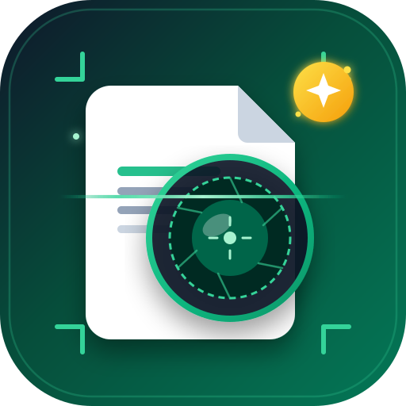

# PageLens — Smart Mobile Document Studio & AI PDF Lens 🔍📄

<div align="center">



### Intelligent, 100% Client-Side Private Document Studio & Mobile PWA

[](package.json)
[](LICENSE)
[](manifest.json)
[](index.html)
[](capacitor.config.json)

**Package ID**: `com.pagelens.ai` • **Mobile Platform**: Android & Progressive Web App (PWA)

</div>

---

## 🌟 Overview

**PageLens** is an all-in-one document intelligence suite and AI resume studio built for mobile devices and modern desktop browsers. Engineered with a privacy-first ethos, all document processing, OCR text extraction, and PDF manipulation happen **100% locally on your device** — zero data or images ever leave your browser or phone.

---

## 📱 Key Features

| Feature | Description | Tech Stack |
| :--- | :--- | :--- |
| **📷 AI Camera Scanner** | Live hardware camera scanner with document boundary framing, front/rear camera toggle, B&W thresholding, Magic Color filter, and Brightness/Contrast controls. | MediaDevices API, Canvas 2D |
| **🔍 Tesseract.js OCR** | High-accuracy Optical Character Recognition extracting raw editable text and generating instant document summaries. | Tesseract.js (Wasm / Web Workers) |
| **💼 ATS Resume Studio** | Interactive multi-section resume builder (Personal, Summary, Experience, Education, Skills, Projects, Certifications) with synchronized live A4 preview and 1-click vector export. | jsPDF, Modern Responsive Grid |
| **🖼️ Photos to PDF** | Multi-image compilation, visual page reordering, individual page rotation, margin adjustment (None, Small, Normal), and format selection (A4, US Letter, Fit to Image). | jsPDF, Canvas |
| **📑 Merge PDF** | Fast lossless merging of multiple PDF documents with intuitive drag-and-drop ordering. | `pdf-lib` |
| **🛠️ Edit & Reorganize** | High-fidelity canvas page thumbnail previews, page rotation, page reordering, extraction of selected pages, and **1-click Undo**. | `pdf.js`, `pdf-lib` |
| **🗑️ Delete Pages** | Visual page selector to excise unwanted pages with instant multi-select and safety confirmation. | `pdf-lib` |
| **🗜️ Compress PDF** | Client-side JPEG quantization with configurable presets (*Extreme ~75%*, *Recommended ~50-70%*, *High Quality ~30%*), displaying file size savings in real time. | Canvas, `pdf-lib` |
| **🕒 Recent Documents** | Offline document history with instant re-download, print via isolated iframe, and native OS sharing. | Web Storage API, Web Share API |
| **🌓 Dynamic Themes** | Precision Emerald & Slate design system with effortless Dark Mode / Light Mode switching and mobile bottom navigation. | CSS Custom Properties |

---

## 📁 Repository Structure

```
PageLens/
├── assets/
│   └── icon.svg                # Brand vector app icon with optics lens & scan beam
├── index.html                  # Semantic HTML5 app structure, 7 modular views & modals
├── style.css                   # Responsive mobile-first CSS, dark theme & animations
├── script.js                   # Unified client-side controller (OCR, jsPDF, pdf-lib, PWA)
├── manifest.json               # Progressive Web App manifest (com.pagelens.ai)
├── sw.js                       # Service Worker for offline caching & background sync
├── package.json                # Project scripts & Capacitor dependencies
├── capacitor.config.json       # Mobile runtime configuration (appId: com.pagelens.ai)
└── README.md                   # Project documentation & guides
```

---

## 🚀 Getting Started

### 1. Run Locally

Because PageLens is built with pure standard web technologies, you can serve it with any local static HTTP server:

```bash
# Using Python
python -m http.server 8000

# Using Node.js npx serve
npx serve .
```

Open [http://localhost:8000](http://localhost:8000) in your browser.

---

### 2. Progressive Web App (PWA)

* **Desktop (Chrome / Edge / Brave)**: Click the **Install** icon in your browser address bar.
* **Mobile (Android Chrome)**: Tap `⋮` menu > **Install app** or **Add to Home screen**.
* **Mobile (iOS Safari)**: Tap the **Share** button > **Add to Home Screen**.

---

### 3. Android App

The native Android project is located in the companion [`pdf android`](../pdf%20android) workspace:

1. Open **Android Studio**.
2. Select **Open** and choose the `pdf android` directory.
3. Allow Gradle to sync.
4. Click **Run 'app'** (`Shift + F10`) or select **Build > Build Bundle(s) / APK(s) > Build APK(s)** to generate the APK.

---

## 🔒 Privacy & Security

* **Zero Cloud Uploads**: Documents, camera feeds, photos, and resume data never leave your browser sandbox.
* **No Telemetry**: No trackers or external analytics scripts.
* **Open Source**: Clean vanilla code that is easy to inspect and audit.

---

## 📄 License

This project is licensed under the [MIT License](LICENSE).
